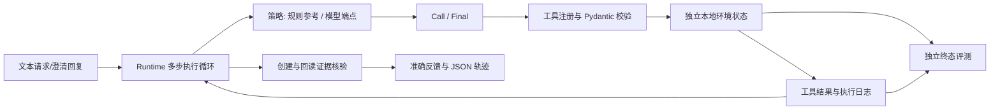

# 架构与行为约定



策略只获得对话和工具签名，不直接读取天气夹具、初始日程或故障开关。每个环境复制场景，防止评测和未来多条 rollout 共享写入状态。

## 示例任务的解释

规则参考策略支持“不下雨且空闲则跑步，否则拉伸”的中文演示任务。两种活动沿用用户提供的同一时长和提醒提前量。任意意图、多城市歧义、多候选时间和复杂偏好不在规则基线的支持范围内；不应把它描述成通用语言模型能力。

天气为 sunny/cloudy 时视为不下雨；rain 时选择室内拉伸。未知天气返回失败，不假定晴天。

“否则室内拉伸”不会取消原有会议。若原时段已有安排，选择室内拉伸并在后续两小时查找最早空档，先提出时间，收到明确同意再创建。用户回复取消时不写入。查询与创建之间出现新冲突时，同样重新找空档、询问用户。

规则基线将这些简短回复视为对当前顺延提议的确认：可以、同意、确认、同意顺延、可以顺延、好的。规则策略仍仅支持演示运动意图。工具环境已支持修改、删除及提醒联动；L6 在 `Session.submit(text, goal)` 中用新 Runtime 共享状态处理。调用方不能在已完成的 Runtime 中继续发起新意图；CLI 提供 `/new`。

## 时间与工具

- 所有状态时间带 UTC 偏移，环境提供 IANA 时区。相对日期按环境当地日期计算。
- 支持今天/明天/后天/大后天、`YYYY-MM-DD`、上午/下午、半点和 24 小时制。
- 无时段的“六点”、跨日不清的“晚上十二点”、夏令时不存在或重复的当地时间均拒绝猜测。
- 日程使用半开区间 `[start,end)`；前一活动结束时可立即开始后一活动。
- `calendar_create` 再次检查冲突。写入采用幂等键，同键同参返回同一结果，同键异参返回错误。
- 日程与提醒是两个独立写入，提醒失败时保留日程并报告部分完成，不执行隐式回滚。

十四个工具：`clock_now`、`time_resolve`、`calendar_list`、`weather_get`、`calendar_find_slot`、`calendar_create`、`calendar_get`、`reminder_create`、`reminder_get`、`calendar_update`、`calendar_delete`、`activity_search`、`preferences_get`、`user_ask`。时钟、解析和回读工具是执行核验的辅助工具。

`calendar_update` 支持可选 revision 检查、冲突检测和提醒联动，校验失败时整次不写入；`calendar_delete` 级联删除关联提醒。被删除的 ID 不复用。活动搜索只返回目录候选，偏好查询只返回已配置值，不替模型决定活动。

真实用户可通过 `Final.requested_slots` 澄清后续答复；配置了确定性用户时，`user_ask` 只回答尚缺失且明确被询问的字段。用户答案、目标谓词、故障计划与 family/split 标签保留在环境私有信息中。TRL 中任务通过 `episode_json` 进入 `reset`，不会拼进模型请求。

工具返回统一为 `{"ok":true,"data":...}` 或 `{"ok":false,"error":{"code":...,"message":...}}`。输入不符合 JSON Schema/Pydantic 校验时不改变状态。

## 核验与评测边界

原演示 Runtime 只有在本次任务创建了一个日程和一个关联提醒、且两者在创建后均回读成功时，才接受 `success`。通用任务显式提供私有 `GoalSpec`，可校验纯查询、活动、关联提醒、修改与删除；成功依赖终态谓词和回读证据。成功说明由实际状态生成，不直接展示模型自述。其他写入结果也会披露；达到步数限制或模型服务异常时保留已执行状态并报告部分完成。

`raw_finals` 记录模型原始结构化反馈；奖励读取它，不能用 Runtime 修正后的回复掩盖模型虚报。当前事实一致性仅覆盖结构化状态及对象 ID，不声称已经自动判定自由文本中的所有语义事实。

这验证“写了什么、是否回读”，**不证明模型正确理解了任意自然语言目标**。条件分支、用户要求、时间和过程约束由独立评测按预先指定的期望检查。模型可能执行合法但不符合用户目标的工具调用，这应计为任务失败。当前没有真实服务的权限控制、并发持久化或推送机制。

模型和规则策略统一返回 `Call` 或 `Final`，但规则解析器不替模型完成参数选择。接入模型后不使用规则策略兜底，以免混淆模型能力和工程补救。

## 故障配置

场景的 `faults` 支持：

```json
{
  "event_create_failures": 1,
  "reminder_create_failures": 1,
  "race_before_create": true,
  "unavailable": ["calendar_get"]
}
```

写入失败次数会递减；race 在第一次非幂等命中的创建前插入临时会议；unavailable 让指定的外部工具调用返回不可用。故障开关只供环境使用，不会作为模型观察泄露。
