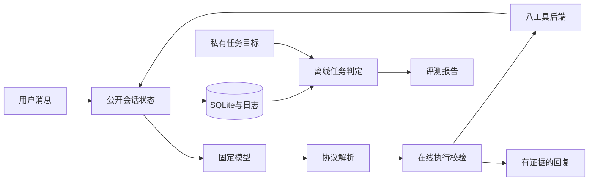

# 项目全程梳理：目标、方法、实现与纠偏

梳理日期：2026-11-18。依据现有代码、数据与验收报告整理。早期文件里的“尚未生成”“尚未训练”等语句描述各自当轮的执行范围，不能当作项目最新总状态。

项目的主线经历了三个层次：先建立可执行、可核验的任务环境，再准备可选的 SFT/GRPO 路线，最后将固定模型的工具执行、状态管理、评测和产品入口接成一个系统。当前采用最后一条主线；已有数据和训练代码保留。

## 1. 最初想解决什么

场景是智能穿戴助手中的日程、天气、活动选择与提醒。例如用户说：“明天18:00，杭州不下雨就安排30分钟跑步，否则拉伸，提前10分钟提醒。”

真正完成任务需要查询天气、确定活动、核对时间与冲突、执行日程与提醒写入，再依据实际状态反馈；缺信息要问，工具出错要恢复，用户后来改主意也要继续处理。

因此最初目标被表述为“查询 → 判断 → 执行 → 核验”，完成与否由真实状态和执行证据判断。当前使用本地模拟业务环境，没有接入手表硬件、真实用户日历或提醒推送渠道。

固定模型指本项目运行时不更新已有 Qwen 检查点的参数。模型使用其已有能力解释请求和提出动作；控制器与工具代码负责执行和核验。

## 2. 五个角色分别负责什么

| 角色 | 职责 | 不应混淆的边界 |
| --- | --- | --- |
| 模型 | 根据公开对话决定下一步工具、参数、澄清或回复 | 不直接执行任意 Python，也不读取私有答案 |
| 控制器 | 维护状态、解析协议、限制预算、检查可见约束与证据、调度执行 | 当前语义规则有覆盖范围，可能误拦截 |
| 工具/环境 | 查询事实、执行原子写入、返回实际结果与错误 | 天气工具不替模型选择活动，查询不等同于完成写入 |
| 参考策略 | 在构造数据时，根据结构化用户意图执行一条有效示范 | 可以使用生成器持有的结构化意图；不作为真实模型能力成绩 |
| 离线判定器 | 根据私有目标、状态和日志检查是否真正完成 | 其答案与评分不进入在线模型决策 |

终局判定可以检查实际状态，还可以检查动作顺序。比如先猜时长创建、再补问，即使最终状态碰巧正确，也可能违反授权与澄清条件。

## 3. 实现过程的五个阶段

| 阶段 | 解决的问题 | 主要产物 |
| --- | --- | --- |
| 早期执行原型 | 工具能否调用、写入与核验，错误能否明确反馈 | `src/lightagent/`、14 工具环境、20 个手写回归场景 |
| 八工具任务工厂 | 如何批量构造可执行、能评分且不泄漏答案的多轮任务 | `wearable_tasks/`、2,900 条正式任务及负例审计 |
| 统一 SFT 数据 | 多源工具对话如何可靠转换、分组、防泄漏和编码 | `data/sft_v1/`、独立 metadata、清洗/长度/mask 报告 |
| 训练准备与容量检查 | 训练入口是否有效，本机能否计算完整轨迹 | 独立环境、模型权重、20 步冒烟、3816-token 单步验证 |
| 固定模型完整系统 | 不继续训练时，如何把环境、模型和评测接成产品闭环 | `src/wearable_assistant/`、三组对照、Web/API、SQLite 与运行脚本 |

### 早期执行原型

最早保留的实现使用 `lightagent`：工具环境、调用策略、运行器、目标判定、HTTP 模型接口、公开数据转换与 TRL 实验骨架。规则参考策略只解决文档中限定的条件运动任务，主要用于验证环境和执行链路。

该阶段报告中的 105 项测试和 20 个规则回归场景属于工程验证。它们不能证明 Qwen 已经完成了这些任务。早期方法说明见 `docs/implementation-4-8.md`，其中的“暂未执行”要结合当时的日期理解。

### 后来为什么另建八工具模块

后续需求冻结了八个业务工具及其返回契约：list_events、create_event、update_event、delete_event、get_weather、search_activity、set_reminder、get_preferences。

旧环境有 14 个工具，工具名、结果结构、目标类型和奖励契约不同。为保留旧工程并冻结新契约，新增 `wearable_tasks`，没有直接把旧工具改名后假定兼容。这也产生了后续必须补接适配层的工程问题。

八工具实现了半开时间区间、冲突检查、原子修改、提醒随日程改时、删除级联、事件 ID 不复用等业务约束。失败不分配对象 ID，不留下部分修改。

## 4. 可执行任务数据怎样构造

数据不是先让语言模型随意编一段“成功对话”，而是：

1. 先确定任务语义、世界结构和授权约束。
2. 先建立任务家族并分配 split。
3. 再生成用户请求、初始日程、天气、偏好、缺失字段、故障与后续用户消息。
4. 让参考策略通过同一工具环境真实执行。
5. 检查终局、动作证据、隔离、重放和公开信息；再导出成功示范。
6. 注入错误，检查评分器是否会错误放行。

难度从单工具查询，到对象查询后写入、条件分支、缺参澄清、错误恢复及用户改意图。天气反事实在同类请求下改变实际天气，要求根据返回选择分支；同名事件和不同时间用于检验对象定位。

正式任务共 2,900 条：训练 2,000、验证 300、同分布测试 200、组合测试 200、鲁棒性测试 200。同一任务家族的复述、参数和反事实变体不拆到不同 split。组合测试保留指定的新组合关系，不是泛指任意未知领域的泛化证明。

公开导出与私有数据分开：公开部分是 case_id、messages、tools；后台保存目标、初始世界、故障计划和模拟用户状态。用户模拟器只在确实询问相关缺参后回答，后续新意图按触发条件出现，不能让模型提前知道。

已有报告验证了 2,900 条参考任务，以及 12,968 次构造负例拒绝检查，构建与验证历史耗时约 34 秒 CPU 时间。负例覆盖错时间、错活动、漏提醒、误删其他对象、重复创建、先猜后问、忽略改意图和伪造查询结果。它们不是 12,968 个独立训练任务，也不代表真实模型成功率。

报告：`data/wearable_tasks/formal/validation-report.json`。判定器：`wearable_tasks/validation.py`。

## 5. 可选 SFT 路线做到了哪一步

### 数据为什么要统一

Hermes/Glaive、ToolACE、自建轨迹的角色、工具定义、调用和返回格式不同。统一数据流程将其转换为只含 tools/messages 的输入：arguments 是对象，工具返回 content 是字符串；许可、来源、原始 ID、分组、行为标签和长度放在独立 metadata。

转换使用合法 JSON 优先、受限字面量解析回退；禁止 eval。工具名变更同步修改定义、调用和返回，并保存映射。多个调用与结果不能安全配对时拒绝该记录，保留合法的错误返回及后续恢复。

公开示范只做格式、Schema 和一致性检查，没有声称在真实第三方 API 环境重执行成功。自建轨迹则有本地模拟环境重放证据。

### 去重、分组与抽样

原始输入 23,195 条；解析/一致性等剔除 3,787 条，完全重复移除 5 条，最终盘点池 19,403 条。随后通过工具定义、调用结构、对话内容和单轮/多轮前缀关系建立分组，整组划分 split，再抽样。

Hermes 单轮和多轮可能是同一任务的前缀关系，不能一个进入训练、另一个进入验证。清洗后报告记录了 832 条有效前缀关联；早期原始文件的匹配统计与此口径不同，不能混用。

公开行为供给不足时，没有把普通聊天强行标成澄清或无需调用。公开混合比例从候选的 30%/50%/10%/10%，调整为有证据支持的 37.5% 调用生成、62.5% 反馈续执行；自建的澄清轨迹仍完整保留。无需调用类的供给缺口被如实记录。

### 几组数量为什么同时存在

| 数据口径 | 训练 | 验证 | 用途 |
| --- | ---: | ---: | --- |
| 最终统一数据 | 9,000 | 700 | 7,000 公开训练＋2,000 自建；验证为 400 公开＋300 自建 |
| 4096-token 训练视图 | 8,997 | 700 | 整条跳过已获同意的 3 条超长记录，自建 2,000 条全部保留 |
| 512-token 短视图 | 383 | 23 | 只做本机冒烟；均为公开短示范 |

三类各 200 条自建测试一直独立保留，没有拿来补训练数。测试任务与其参考轨迹是离线评分资源，不是训练输入。

短视图少的原因是一个完整输入包括 system、八工具 Schema、全部对话和返回。用户只说一句话，编码也可能远超 512 token。自建轨迹全部大于 512，不能删工具、反馈或用户改意图来塞入短视图。

### 长度与 mask 的两次关键修正

最初长度统计把编码返回字典的字段数量当作 token 数。后来改为读取真正的 input_ids，原错误盘点标记无效，对完整数据重新计数。旧大数据目录清理后保留了报告归档，当前有效池仍在 `data/sft_v1_inventory`。

Qwen 原生模板的 system-only 和连续 tool 片段也有前缀边界问题。审计改为遵循真实模板边界，保证 assistant 调用、澄清、回复和结束 token 参与 loss，system/user/tool 返回保留在输入但被 mask。

另外补齐了 TRL 跳过预处理时所需的 labels 和对话格式标识，并避免 Arrow 把不同 API 同名参数强行统一为同一类型。实际训练只转发编码后的 input_ids/attention_mask/labels，工具协议没有丢失。

## 6. 本机训练准备与硬件验证

目录名包含 ms-swift，但当前训练代码实际使用 TRL、Transformers 和 PEFT/LoRA。原轻量环境、数据环境和 CUDA 训练环境分别保留，避免数据依赖与训练依赖互相升级。

本机为 P1000 4GB。不能因为模型或配置写了 BF16，就认为硬件支持原生 BF16；检查排除了软件模拟。采用的本机实验路径是 NF4、FP32 compute、小 rank LoRA、batch 1 和梯度检查点。

已经真正执行的训练相关验证：

- 512-token、20 个优化器更新步的冒烟完成，LoRA 参数确认变化，耗时约 18.6 分钟，PyTorch 分配峰值约 3.38GiB。
- 1024-token 和 2048-token 真实完整轨迹完成重复前向/反向。
- 当前 4096 视图内最长的 3816-token 轨迹完成前向、反向和一次临时 LoRA 更新，约 289 秒前后向，PyTorch 分配峰值约 7.45GiB；没有保存这次临时 adapter。

大于物理 4GB 的分配依赖 Windows 共享 GPU 内存，不能解释为全部装入独立显存。单条通过也不能证明整轮稳定性。最初两次长轨迹重复测试超过整项六分钟预算，报告保留 timeout；这不是 CUDA OOM。后来单次更新在较长预算内通过。

期间有过将“本机适配”配置指向 383 条短样本单轮的范围偏差；这不满足完整数据训练意图。后续通过独立的短视图和完整视图配置纠正，完整视图保持 8,997 条，不再把冒烟配置当完整训练。

A100/3090 的整轮时长只做过预算估计，没有远程 GPU 实测结果。整轮完整 SFT 没有完成记录。证据见 `reports/p1000-long-context-report.json` 和已有 smoke run-manifest。

## 7. GRPO 与 Rubric 为什么还不能算完成

最初研究路线是：公开/自建示范 SFT → 在真实可执行环境中采样多个候选 → 按终局与过程证据评分 → GRPO 优化 → 固定任务评测。

代码中存在两套评分基础：旧 lightagent 的 manual-v1 为 R=S+0.1P-0.05C；当前八工具环境采用终局二值奖励，全部必需条件通过才为 1，其中包含授权、澄清、必要查询和用户后续指令等过程条件。

面向当前任务的增强复合 Rubric、自动 Rubric 或自然语言 Judge 仍是后续方案，不是已经做完的训练实验。当前运行器将确定性检查用于执行核验和失败诊断，不更新模型参数。

就绪审查发现的实际阻塞包括：旧 GRPO 入口要求另一种 EpisodeSpec，而当前任务是 case_id/messages/tools；SFT 输出 adapter，而旧 GRPO 路径指向不存在的历史合并模型；max_steps 仍为 20；验证集、正式预算、奖励消融和多 seed 实际配置没有接全。

公开数据的历史 API 返回不能直接变成可重置的 RL 世界。新纯推理 TaskBackend 也不自动等于 GRPO Trainer 适配器，训练还涉及 rollout 分组、工具 token mask、奖励来源和参考策略等专门接入。

因此保留训练分支作为可选研究模块，先将固定模型系统接完整。见 `reports/remote-experiment-readiness.json`；其中关于推理桥接的旧状态由后续 assistant-system 报告补充，关于 GRPO 训练的阻塞仍需单独解决。

## 8. 当前固定模型系统怎样运行

### 两个服务、三个后端分别是什么

- 8000 是模型推理服务：加载 Qwen 权重，接收 messages/tools，生成文字或工具调用。当前默认路径是 `models/Qwen3.5-2B`，不会自动加载 20 步冒烟 adapter。
- 8765 是助手服务：提供页面/API、会话、工具调度、状态与日志，并调用 8000。调用外部推理 API 时，这个助手进程本身不需要 GPU。
- TaskBackend 用于正式任务评测，从私有任务库建立隔离模拟世界并在结束后取离线判定；LocalBackend 用于人机交互，加载示例世界，由真实用户回答澄清；HTTPBackend 用于未来配置的真实业务网关。

普通聊天不会自动加载整个 9,000 条 SFT 数据，也不从私有任务库读取正确答案。示例世界是固定时钟和有限天气表，查到 NOT_FOUND 时不能编造天气；它不是在线天气服务。

`.venv-train` 是依赖环境的名称，使用它启动推理不等于训练。`run_assistant.ps1 -Task model -Execute` 只推理，`-Task serve -Execute` 启动助手，`-Task evaluate -Execute` 执行模型评测；`lightagent.training --execute` 才是训练入口。各模块的 Execute 都是显式执行开关，其作用由具体命令决定。

模型和控制器看不到图中的私有任务目标。在线检查的依据来自公开请求与实际反馈；离线评测再检查其是否真正满足完整任务目标。

| 当前文件 | 作用 |
| --- | --- |
| `src/wearable_assistant/protocol.py` | HTTP 模型调用、严格 JSON、原生工具/澄清/最终回复解析 |
| `src/wearable_assistant/model_server.py` | 可选本地 Transformers 推理端点，将当前 Qwen XML 工具协议转换为标准 tool_calls |
| `src/wearable_assistant/backends.py` | 正式任务后端、交互模拟后端和可配置 HTTP 业务网关；私有任务加载留在后台 |
| `src/wearable_assistant/runtime.py` | 三组运行策略、公开状态、执行预算、重试、幂等、核验、部分成功说明 |
| `src/wearable_assistant/evaluation.py` | 三类测试、对照、逐例保存、签名校验、续跑、指标与重放 |
| `src/wearable_assistant/service.py` | SQLite、请求去重、取消、HTTP API |
| `src/wearable_assistant/web.html` | 查看对话、执行时间线、状态与回执的本地页面 |
| `scripts/run_assistant.ps1` | 预览、工程检查、模型服务、界面、冒烟与正式评测入口 |

### 一条任务的实际执行链

1. 用户请求进入会话，系统只记录公开参数和上下文。
2. 模型收到完整工具定义，提出原生调用或澄清。
3. 解析器恢复名称与参数；多调用无法按本轮协议安全执行时整体拒绝。
4. full 组校验 Schema、已知对象、可见授权、缺参和重复写入。
5. 执行前保存待处理调用日志；后端执行并返回真实结果。
6. 回填 tool 消息；出现新的用户要求时更新意图版本。
7. 创建/修改/删除使用查询回读核验，并检查实际结果与原提交参数一致。后端错误创建 40 分钟、回读也是 40 分钟，并不能满足用户提交的 30 分钟请求。
8. 最终回复接受证据检查。部分成功由实际写入回执生成说明，模型的原始回复另行保存，不能把“什么都没创建”直接展示给已经发生写入的用户。

当前八工具没有单独的提醒读取工具，提醒只核验回执与事件时间一致性，不宣称验证了真实通知投递。

### 状态与恢复补充了什么

会话记录已知槽位、意图版本、对象 ID、待处理调用、等待用户和未知写入状态。重启从 SQLite 恢复；外部写操作不为重放而再次执行。请求 ID 相同且内容相同返回已有结果，内容变化会被拒绝；网关还需真正支持幂等键。

工具超时的含义必须区分：只读临时失败可以有限重试；写入无回执可能已经生效，要标记结果未知，避免再次创建。

点击停止表示在途调用返回后不再执行后续步骤，不会自动撤销已有写入。用户要撤销已创建日程时，应明确要求删除，产生一条新的、有授权的工具动作。

## 9. 不训练时怎样做实验

固定同一个模型、数据、温度、seed 和预算，比较：baseline 原生工具循环；state 增加公开状态；full 再增加校验、有限恢复和写后核验。

每组 600 条，三组共 1,800 个模型任务。每条都从隔离世界开始。模型原始声称、系统对外结果和私有任务评分分别保留，以区分模型能力、系统拦截收益和控制器误拦截。

主要指标包括任务成功、澄清、用户改意图、未授权写入、重复创建、原始虚报、对外虚报、误拦截、重试、调用数、耗时与 token。状态和回读有成本，不能只看成功率不看额外调用。服务不返回 usage 时记缺失，非流式端点的 TTFT 记 null。

训练集现在也可用于提示示例和错误分析，验证集用于调试，三类测试集保持冻结。当前没有把 9,000 条训练示范全部塞进提示词，也没有通过测试答案决定线上动作。

## 10. 中间问题与解决方式汇总

| 问题 | 处理 | 验证边界 |
| --- | --- | --- |
| 旧 14 工具与新 8 工具协议不一致 | 冻结新模块，新增专门推理接入层 | GRPO 训练适配仍是另一项工作 |
| 公共数据解析/配对含糊 | 受限解析、同步名称映射、无法消歧则拒绝 | 不声称公开 API 重执行 |
| 单轮/多轮与近重复跨 split 风险 | 家族分组后划分，再抽样 | 词面分组不是完整语义去重证明 |
| 澄清/无需调用供给不足 | 报告缺口、调整比例 | 不强行给普通聊天贴标签 |
| 误把编码字典长度当 token 数 | 改读 input_ids、标记旧盘点无效并重计数 | 旧错误报告保留归档 |
| Qwen 前缀边界与 mask 不可靠 | 按真实 system/连续 tool 边界审计 | 不用首条样本代替全部类别检查 |
| TRL 格式与 Arrow 类型冲突 | 明确 labels，辅助对话列去除跨 API 参数类型冲突 | 编码中的完整工具协议保留 |
| P1000 BF16/显存与速度限制 | 原生 BF16 检查、NF4/FP32、检查点、小 rank | 共享内存单步通过不等于整轮稳定 |
| 本机配置一度变成仅短样本训练 | 将短视图与完整视图拆成独立配置 | 明确保留 8,997 条正式训练范围 |
| Windows 工具输出解码问题 | 本项目环境采集改为字节捕获及兼容解码 | 不宣称修复所有第三方线程输出 |
| 包只包含 src，缺 root 下任务环境 | 补打包映射与 Web 资源，验证独立安装 | 不是只在仓库当前目录能导入 |
| 协议、回执与中断造成重复/虚报 | 严格解析、持久化、未知写入保护、原始/受控回复分离 | 有界规则仍需真实模型评估 |
| 历史报告状态互相看似矛盾 | 保留分阶段证据，增加当前导航与本梳理 | 当轮未执行不代表项目从未执行 |

## 11. 当前已验证什么、还未验证什么

截至代码验收，172 项项目测试（其中 39 项新增系统测试）和 23 项冻结环境测试通过。新测试使用脚本模型、假 HTTP 服务和 CPU tokenizer 检查；它们证明协议与控制流程，不是模型在真实任务上的得分。

已有真实 GPU 证据是前述 P1000 训练冒烟和长轨迹单步。完整 SFT、GRPO、正式 600/1,800 条模型评测、BFCL 正式成绩和真实业务账号接入没有完成记录。

本次梳理时只读检查：本机 `http://127.0.0.1:8000/v1/models` 返回 HTTP 200，模型名 Qwen/Qwen3.5-2B；P1000 推理服务已经启动。`8765/health` 当时未响应，输出目录未发现正式 assistant 评测报告。本次没有发送生成请求。

服务启动、单条任务跑通、工程测试通过、正式能力评测完成、真实业务上线是不同的验收层次。当前处于“代码和工程验收完成，进入本机真实模型运行验收”的阶段。

真实业务仍需配置厂商网关与凭证。当前是本地单进程开发服务，一个 SQLite 数据库只由一个执行进程负责；不包含生产多租户、完整中文语义验证或真实穿戴设备集成。

## 12. 现在怎么理解下一步

先启动助手 Web/API，做天气查询、缺参创建、修改/撤销等少量交互，核对日志；再运行验证集 5 条冒烟，修复端点和协议问题；最后冻结配置，执行正式测试和三组对照。

以后若继续研究训练，可将 SFT/GRPO 检查点换到同一模型接口上，用相同任务、控制器和预算比较。这样训练带来的变化与系统工程带来的变化才有可比较的依据。

实际运行指令：[assistant-system.md](assistant-system.md)。目录导航：[project-layout.md](project-layout.md)。最新工程验收：[assistant-system-implementation.json](../reports/assistant-system-implementation.json)。
